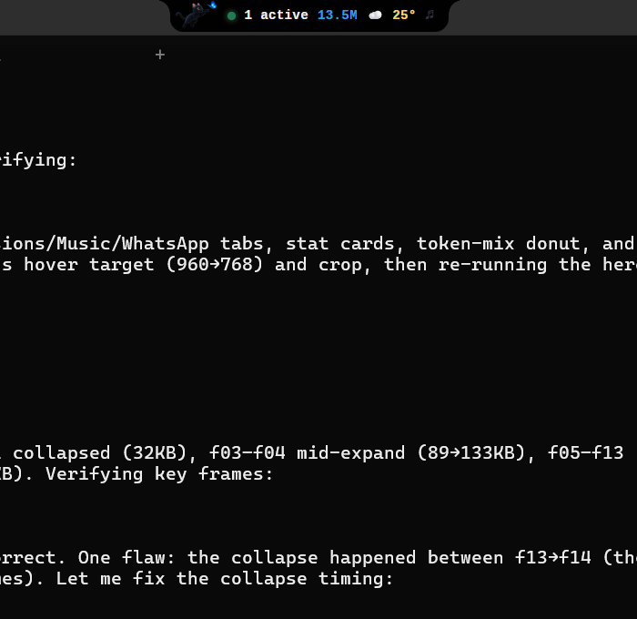
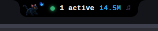
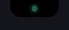
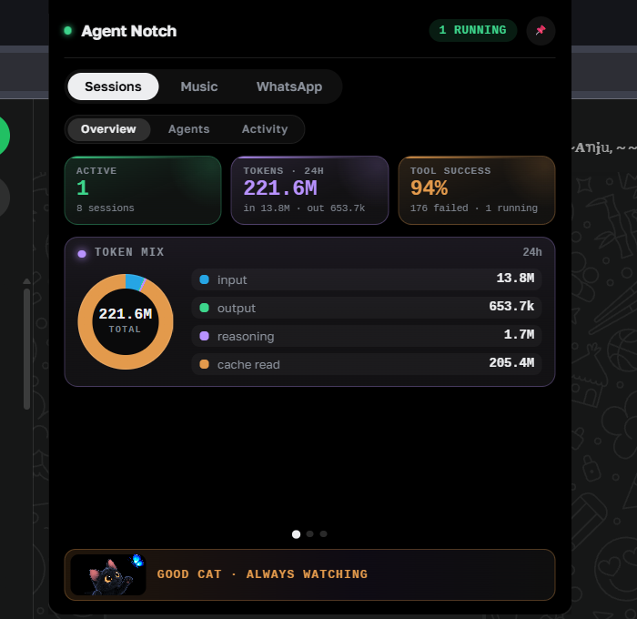
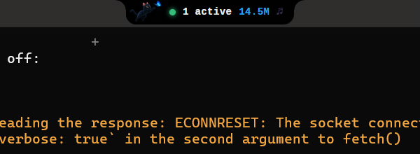

<div align="center">

# 🐈‍⬛ agent-notch

**A Dynamic-Island-style notch for Windows that watches your OpenCode sessions.**

Solid-black pill pinned to the top of the screen · live tokens & tool stats ·
WhatsApp remote control · daily newspaper digest · a cat that is always watching.

[](https://github.com/Pavankumar-p-k/flow-)
[](https://www.electronjs.org/)
[](#-test-suite)
[](https://nodejs.org/)
[](package.json)



<br><sub><b>Hover to expand · cursor-away auto-collapse · 📌 pin to keep it open</b></sub>

</div>

---

## ✨ What it does

The notch is a borderless, click-through-by-default window that lives at the top-center
of your screen 24/7. It never steals focus, never blocks clicks, and only comes alive
when you point at it.

| | | |
|:--:|---|---|
|  | **Solid Dexter-style body** — pure `#000`, radius 12, 12px shoulder flares, white glow. No acrylic, no blur, no arrow. |  |
| <sub>**Left:** collapsed pill · **right:** the 56×20 nub</sub> | **Modes are CSS-only** — `Ctrl+Alt+M` shrinks to the nub, `Ctrl+Alt+H` hides completely. State persists in `config.json` and is re-applied at boot. | <sub>**Right:** shrunk nub</sub> |



<sup>The expanded dashboard: live session count, 24h token totals, tool success rate,
a token-mix donut (input / output / reasoning / cache-read), three tabs and the cat footer.</sup>

### Feature summary

<details>
<summary><b>🖥️ Live session dashboard</b> — Sessions / Music / WhatsApp tabs</summary>

- **Overview** — active session count, 24h token total, in/out split, tool success rate,
  and a token-mix donut chart fed straight from the OpenCode service.
- **Agents / Activity** — per-agent rows and the rolling activity feed.
- **Pill stays quiet** — the collapsed pill only shows `sessions · tokens · weather · music`.
  Urgent events (failed run, pending approval) push; everything else waits for you.

</details>

<details>
<summary><b>⌨️ Hotkeys & modes</b></summary>

| Hotkey | Effect | Persisted as |
|---|---|---|
| `Ctrl+Alt+M` | Shrink to a 56×20 nub | `config.notchMode = "shrunk"` |
| `Ctrl+Alt+H` | Hide completely (still running) | `config.notchMode = "hidden"` |
| `Ctrl+Alt+…` (tray menu) | Same toggles from the tray | — |



All three modes are pure CSS classes (`body.notch-shrunk` / `body.notch-hidden`) — the
transparent window is **never** `win.hide()`-ed, so hit-testing and hotkeys keep working.
The boot sequence pushes the persisted state to the renderer before the first frame.

</details>

<details>
<summary><b>🌘 Full-screen auto-dim</b></summary>

A PowerShell watcher reports the foreground window. When a game / video player /
`F11` browser covers a whole monitor **without a caption bar**, the notch drops to
**30% opacity** so it stays out of the picture — hovering it brings it back to full
brightness instantly. Your fullscreen movie keeps its pixels; you keep your controls.

</details>

<details>
<summary><b>📰 The daily digest — a newspaper, not a notification</b></summary>

The digest sends itself at the **first laptop open of the day** (quiet floor **05:00** —
opens before that count as yesterday's, so a 2am session can't trigger it; the day is
marked *before* the send loop so a crash can't double-send).

Each pack is assembled like a newspaper front page:

> ☀️ weather · 📊 status / tokens / tools · 🔕 DND · ⏰ reminders · 📡 model radar
> 🔗 chain status · 🔍 self-audit · 📰 HN top-5 · 🏢 company headlines (giants)
> 📁 repos + ghwatch · 💬 pending prompts

Commands: `digest` (send now) · `digest at 18:00` · `digest auto` (first-open) ·
`digest status` → `first-open · today: sent · last: Tue Nov 24 2026 06:18`

</details>

<details>
<summary><b>⚡ On demand — <code>brief</code>, <code>links</code>, <code>open</code></summary>

| Command | Returns |
|---|---|
| `brief` / `summary` / `tldr` / `short` | An 8-line gist of the day: weather, radar, chain, top story, audit tail, repos |
| `links` | The paper's URLs as a numbered list |
| `open 3` / `open hn` / `open giants` / `open all` | Opens those exact tabs in your default browser |

Opening is **awaited per URL**, sequential (paper order); if any tab fails you get
`⚠️ 2 of 5 tab(s) failed to open` instead of a fake success. `open` uses a strict
full-message vocabulary, so `"open notepad"` and `"open github.com"` still go to the
assistant. If the network was down at boot, `brief`/`links` fall back to the **persisted**
page rather than reporting nothing.

</details>

<details>
<summary><b>💬 WhatsApp bridge — your phone is the remote</b></summary>

Messages run **strictly one at a time, in a FIFO queue** (max 8). Control commands
(`stop`, `skip`, `queue`, `clear`, `allow/reject`) **bypass the queue** so you can always
preempt a runaway task. Attachments ≤16MB are read back; voice notes are transcribed.

**Fresh screenshots are slash-only:**

```
/screenshot              → immediate capture
/screenshot window       → the foreground window
/screenshot <app title>  → a specific app
/screenshot region       → drag-select a region
/ocr  ·  /ocr full       → local Windows OCR (no cloud)
```

Plain *"send me a screenshot"* text goes to the assistant instead (which answers the
question — old screenshots come back as files). See the full list below.

</details>

<details>
<summary><b>🤖 Assistant on a model chain with network awareness</b></summary>

The assistant runs on `opencode/mimo-v2.6-flash-free` with a fallback chain:

```
mimo-v2.6-flash-free → deepseek-v4.1-flash-free → hy4-flash-free
        ↑ advanceModel() steps the chain on rate-limits & real failures
```

- **Transport failures are never judged** — they report `🌐 … (network — not judged)`,
  do **not** advance the chain, do not push a failure to your phone.
- Recovery pushes only fire from `fail`/`limit` states; **429 stays `limit`**.
- Ask it anything naturally: *"open notepad"*, *"what app is in front"*, *"how many tabs
  are open"*, or just have a conversation.

</details>

<details>
<summary><b>🧰 The rest of the toolbox</b></summary>

- **Reminders** — `remind in 10m <text>` · `remind at 18:30 <text>` · `cancel <n>` — persisted, missed ones fire late, not lost.
- **ghwatch** — `ghwatch owner/repo` watches issues/PRs/CI and pushes on changes.
- **weather** — current + 4-day, `weather <city>` sets the default.
- **news** — `news` (HN top-5 + company headlines), `news hn`, `news <company>`; seen stories persist so the digest never repeats.
- **DND** — `dnd on 30m` / `dnd off` silences pushes and the 🔔 mirror.
- **clipboard** — `copy <text>` · `clipboard / paste`.
- **sessions** — `run <n> <prompt>` · `stop <n>` · `queue` · `clear`.
- **config** — `config` · `config mirror off` · `config digest 18:00`.
- **File drop** — drag files onto the notch → they land in the WhatsApp outbox.
- **Tray** — show/hide, mode toggles, replay the intro, quit.
- **Watchdog** — `scripts/watchdog.ps1` (scheduled task, every minute) relaunches the app if the process dies, honoring a `notch.stop` file.

</details>

---

## 📚 Command reference

Send any of these to the WhatsApp bridge (`help` prints this list):

| Category | Commands |
|---|---|
| **Status** | `status` · `sessions` · `repos` · `prompts` · `reminders` · `help` |
| **Digest** | `digest` · `digest at 18:00` · `digest auto` · `digest status` |
| **On demand** | `brief` · `summary` · `tldr` · `short` · `links` · `open <n>` · `open hn` · `open giants` · `open all` |
| **Screenshots** | `/screenshot` · `/screen` · `/screenshot window` · `/screenshot <app title>` · `/screenshot region` |
| **OCR** | `/ocr` (drag-select) · `/ocr full` (whole screen, local Windows OCR) |
| **News** | `news` · `news hn` · `news <company>` |
| **Weather** | `weather` · `weather <city>` |
| **Repos** | `ghwatch <owner>/<repo>` · `ghwatch` · `ghwatch off` |
| **Reminders** | `remind in 10m <text>` · `remind at 18:30 <text>` · `cancel <n>` |
| **Sessions** | `run <n> <prompt>` · `stop <n>` · `stop` · `skip` · `queue` · `clear` |
| **Disturbance** | `dnd on 30m` · `dnd off` |
| **Clipboard** | `copy <text>` · `clipboard` · `paste` |
| **Settings** | `config` · `config mirror off` · `config digest 18:00` |
| **Approvals** | `allow` · `always` · `reject` · `2 allow` · `1 reject` · `1: <your answer>` |
| **Natural talk** | *"open notepad"* · *"play music"* · *"next song"* · *"what app is in front"* |

> **FIFO rule:** ordinary messages run one at a time in order (queue, max 8).
> Control commands above **bypass** the queue — you can always interrupt.

---

## 🚀 Quick start

```powershell
git clone https://github.com/Pavankumar-p-k/flow-.git
cd flow-
npm install
npm start            # = electron .
```

**Launching manually** — always pass the app path, or Electron opens its default app
instead of the notch:

```powershell
Start-Process -FilePath ".\node_modules\electron\dist\electron.exe" -ArgumentList "." -WorkingDirectory (Get-Location)
```

> The watchdog (`AgentNotchWatchdog` scheduled task) already does this correctly and
> relaunches the app within a minute if the process disappears.
> Create an empty `notch.stop` file to keep it paused.

**First run** shows a short intro (press `Esc` to skip, replayable from the tray),
then the pill appears at the top-center of your screen. Scan the QR from the
WhatsApp panel to pair your phone.

---

## 🧪 Test suite

```powershell
.\scripts\run-tests.ps1          # run everything
.\scripts\run-tests.ps1 -Full    # include verbose output
```

The runner auto-discovers every `scripts/test-*.js` (**26 files**, `test-continue` excluded —
it drives the real assistant and opens real apps), runs files **strictly sequentially**
because they share live state, retries a failed file **once**, and reports:

```
PASS / FLAKE / REAL-FAIL   ·   per-file timing   ·   non-zero exit only on real failures
```

Covers: model probe & network-status semantics · digest scheduling & clock-back guard ·
news persistence & offline fallback · atomic writes (`fsutil`) · self-audit log tail ·
FIFO queue & control bypass · open-tab failure reporting · fullscreen classifier ·
hotkey modes · reminders · weather · and more.

---

## 🗂️ Project structure

```
agent-notch/
├── main.js            # window, tray, hotkeys, hover watch, fullscreen dim, watchdog glue
├── renderer.js        # panels, charts, pill layout, CSS-only mode classes
├── style.css          # the Dexter look: #000 body, radius 12, shoulder flares, glow
├── index.html         # notch markup (pill + expanded panel + veil)
├── preload.js         # IPC surface for the renderer
├── bridge.js          # WhatsApp bridge: FIFO queue, commands, digest, open/links, approvals
├── assistant.js       # model chain (mimo → deepseek → hy4), MODEL_CHAIN fallback
├── news.js            # HN + company headlines, persisted seen-page, brief/links fallback
├── weather.js         # current + 4-day (IP-based or city from config)
├── ghwatch.js         # repo watch (issues / PRs / CI)
├── repos.js           # git repos scan for the digest
├── selfaudit.js       # 24h self-audit over the last 2MB of debug.log
├── modelradar.js      # model radar pack for the digest
├── modelprobe.js      # chain probing; transport failures → 🌐 (not judged)
├── whatsapp.js        # Baileys socket, pairing QR, reconnect
├── fsutil.js          # writeAtomic (tmp+rename) + readTail
├── dropfiles.js       # file-drop outbox
├── psrun.js           # PowerShell helpers (OCR, screen capture, actions)
├── scripts/
│   ├── run-tests.ps1  # the suite runner (A7)
│   ├── watchdog.ps1   # relaunch guard (scheduled task)
│   ├── fullscreen-watch.ps1  # foreground-window heartbeat for auto-dim
│   └── test-*.js      # 26 test files
└── docs/              # README media (GIFs + screenshots)
```

---

## 🛣️ Roadmap

Hardening (A1–A7) is done and merged. Next up — the **Space & Fun packs**
(deferred while hardening was in flight, now unblocked):

- 🚀 **NASA APOD** — picture of the day in the pill / digest
- 🎮 **Epic free games** — weekly free-game alert
- 🎬 **TMDB** — what to watch tonight
- 🎧 **Listening report** — your music week in numbers

---

<div align="sub">

Made with ☕ and one very attentive cat · **`GOOD CAT · ALWAYS WATCHING`**

</div>
